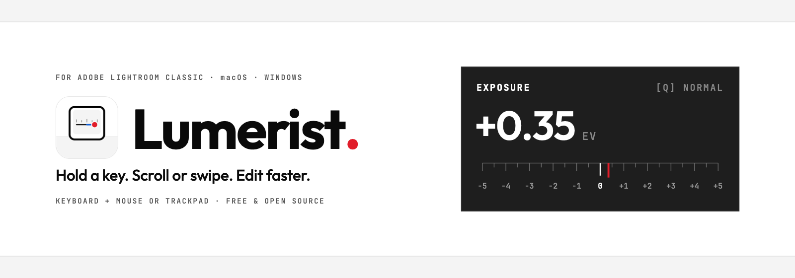
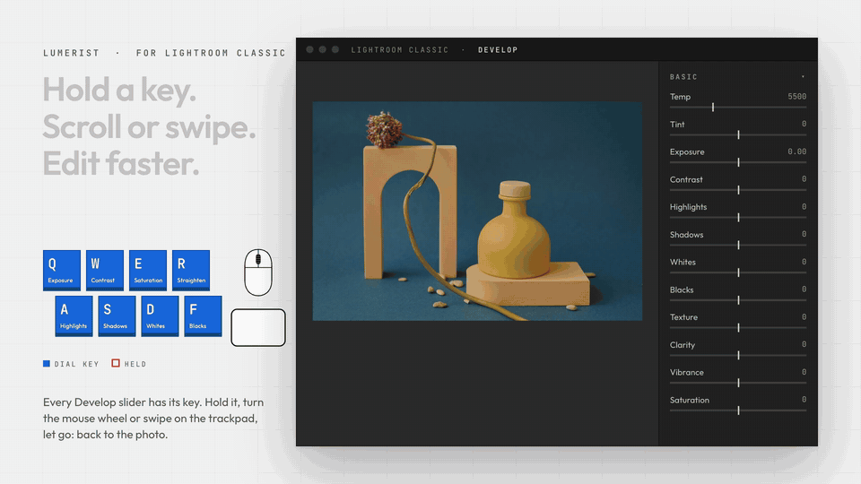
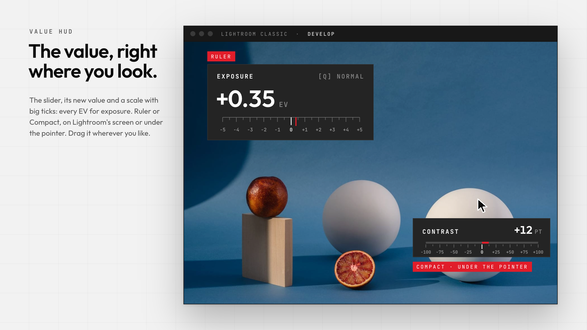
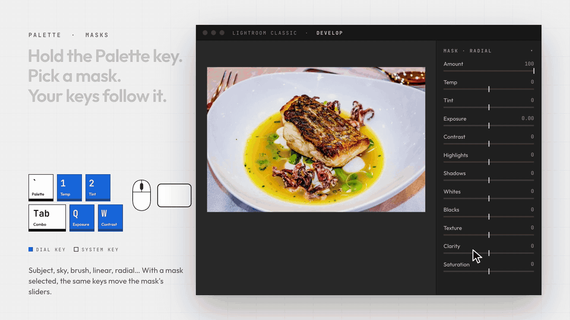
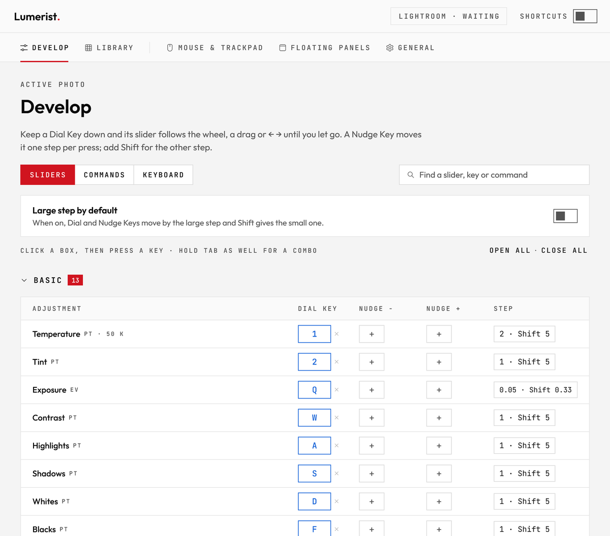
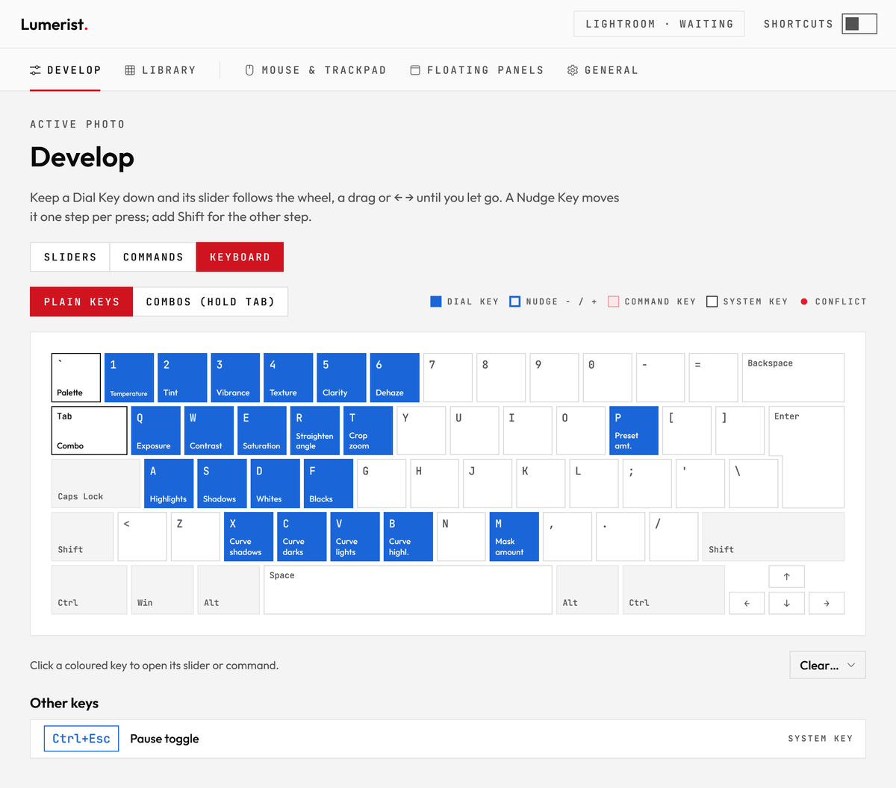
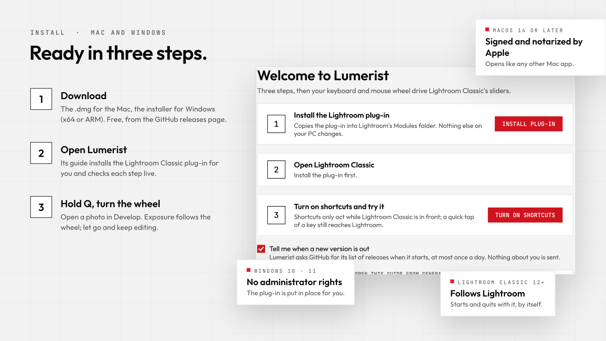
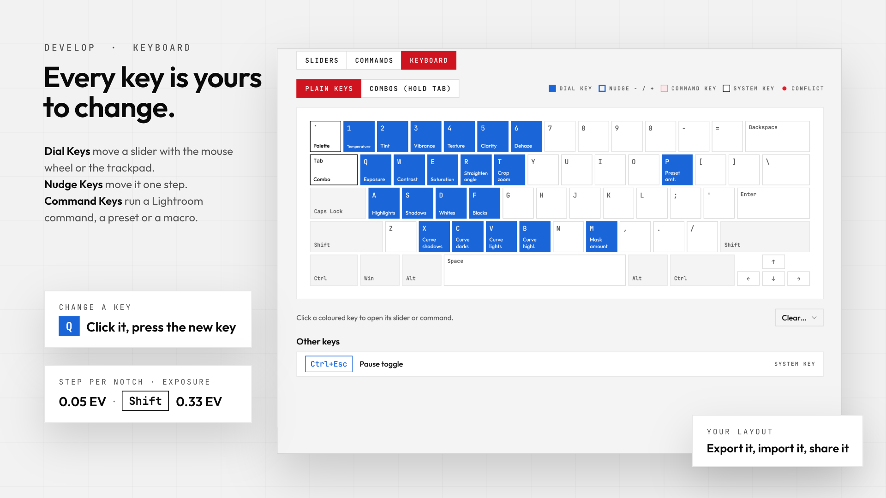
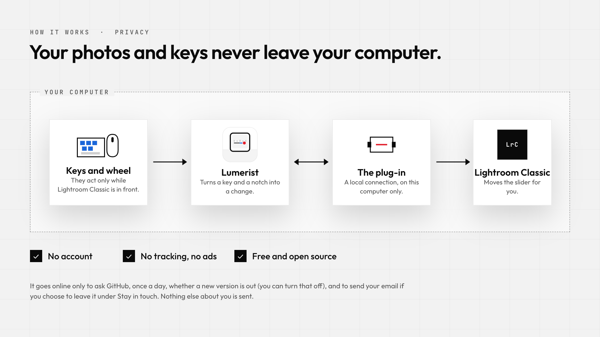
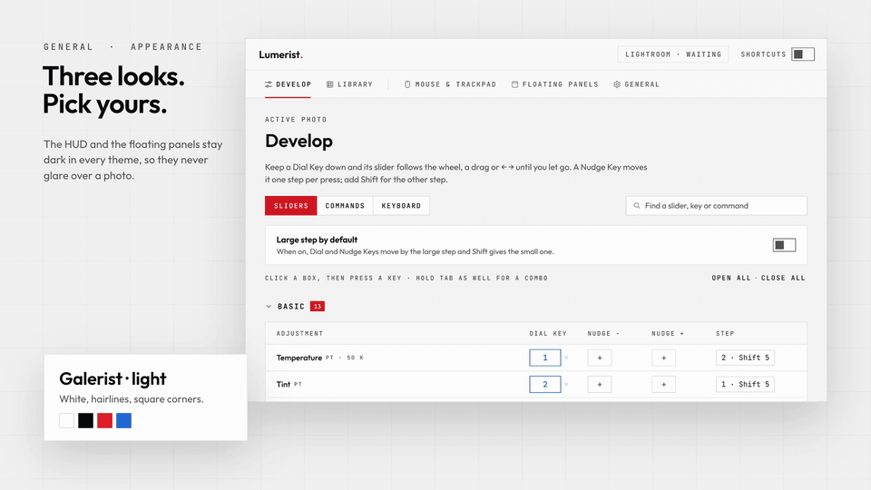

  

  
  
  
  
  
  
  

  <b>Free, open-source editing with the keyboard and the mouse or trackpad, for Adobe Lightroom Classic on the Mac and on Windows.</b> 
  Hold a key, turn the mouse wheel or swipe on the trackpad, watch the slider move — without ever leaving the photo.

  <b>Made to edit faster.</b> With Lumerist I edit my photos <b>at least 5× faster</b> than dragging Lightroom's sliders with the pointer. 
  That's my own rough figure: how much time you save depends on how you work.

  

  <a href="#install-in-three-steps">Install</a> ·
  <a href="#what-it-does">Features</a> ·
  <a href="#the-standard-layout">Layout</a> ·
  <a href="#faq--troubleshooting">FAQ</a> ·
  <a href="#contributing">Contributing</a> ·
  <a href="#support-the-project">Support</a>

---

## Why Lumerist exists

I fell in love with how fast you can edit in **Capture One**: keep one hand on
the keyboard, the other on the mouse or the trackpad, and the sliders follow
you without hunting for them in a panel. When I went back to Lightroom Classic
I missed that flow every single day — dragging tiny sliders with the pointer
felt slow.

So I built Lumerist: a small app for Mac and Windows plus a Lightroom Classic
plug-in that bring that **hold a key, then scroll or swipe** way of editing to
Lightroom Classic. It is free, open source, and runs entirely on your computer.

Lumerist is made by the creator of [Galerist](https://galerist.photo/c/lk-readme),
online galleries where photographers and videographers deliver their work to
clients.

## What it does

  

- **Dial Keys** — hold a key and turn the mouse wheel or swipe on the
  trackpad (a drag or ←/→ work too) to move one Develop slider. Hold ⇧ for the
  larger step. A quick tap still reaches Lightroom, so its own shortcuts and
  your typing keep working.
- **Nudge Keys** — tap a key to move a slider one step down or up.
- **Command Keys** — tap a key to run a Lightroom command (undo, auto tone,
  flags, ratings, colour labels, modules, tools…), apply a Develop preset, send
  one of Lightroom's own shortcuts, or play a macro.
- **Combos** — hold the Combo Key (Tab) and press another key: **Tab + K** is
  a key of its own, for a Command Key or a Nudge Key, while K alone keeps its
  usual job.
- **Masks follow you** — with a mask selected, your keys move the *mask's*
  sliders. Keys with no mask equivalent never touch the whole photo.
- **Library too** — Quick Develop adjustments applied to every selected photo.
- **Palette** — hold the Palette Key for your favourite presets and
  Lightroom's *Create New Mask* tools (subject, sky, background, people,
  objects, brush, linear, radial…). With a mask selected, ⇧-click adds,
  ⌥-click subtracts and ⇧⌥-click intersects, as in Photoshop.
- **Key Reference** — an on-screen list of the keys for the module you are in.
- **Value HUD** — a small read-out of the slider, its new value, and a scale
  with big tick marks (every EV for exposure), in Ruler or Compact style, on
  Lightroom's screen or under the pointer. Drag it wherever you like it.
- **Mouse and trackpad clicks** — double-click with the mouse or the trackpad
  (or middle-click) to reset the held slider; the mouse side buttons move to
  the previous/next photo.
- **About 130 Develop parameters** — Basic, tone curve, HSL, B&W, colour
  grading, detail, transform, lens, effects, calibration, and local mask
  sliders. Every key, step size, and option can be changed.

  

  
  

## Install in three steps

  

### On the Mac

1. **Download** `Lumerist-<version>.dmg` from the
   [releases page](https://github.com/ziago/Lumerist/releases).
2. **Drag** Lumerist into your **Applications** folder and open it. The app
   is signed and notarized by Apple, so it opens like any other Mac app.
3. **Follow the first-run guide.** It installs the Lightroom Classic plug-in
   for you, asks you to (re)start Lightroom, and opens the right privacy pane
   so you can allow Lumerist to read the keyboard, mouse and trackpad:
   *System Settings → Privacy & Security → Accessibility* (on macOS 27 the
   pane is called **Device control and data access**).

### On Windows

1. **Download** `Lumerist-<version>-windows-x64-setup.exe` from the
   [releases page](https://github.com/ziago/Lumerist/releases)
   (`arm64` for ARM PCs; *Settings → System → About → System type* tells you
   which). A portable `.zip` is there too, if you prefer not to install.
2. **Run the installer.** It installs Lumerist for your user only, with no
   administrator rights, and opens it. The Windows version is **not
   code-signed yet**, so the first time Windows shows *Windows protected your
   PC*: click **More info**, then **Run anyway**. The
   [FAQ](#why-does-windows-say-windows-protected-your-pc) explains why, and
   how to check that the file is the genuine one.
3. **Open Lightroom Classic.** The installer has already put the Lightroom
   plug-in in place (if Lightroom was open, it asked you to close it first;
   if you skipped that, the first-run guide installs it). There is no
   permission to grant on Windows. Lumerist lives in the notification area,
   next to the clock: click its icon for the menu.

That's it: open a photo in Develop, hold **Q**, and turn the mouse wheel or
swipe on the trackpad.

Lumerist follows Lightroom Classic: the plug-in starts it in the background
when Lightroom opens, and it quits 3 seconds after Lightroom quits (both can be
turned off in *General*). Closing its window keeps it running. To open its
window from Lightroom, choose *File → Plug-in Extras → Open Lumerist*.

### Updating

Lumerist tells you when a new version is out: when it starts, at most once a
day, it checks GitHub's list of releases (untick *Tell me when a new version
is out* in the first-run guide, or the automatic check in *General*, to turn
this off). The new version then shows in the menu bar item on the Mac, and as
a notification and in the menu of the notification-area icon on Windows.
Click it to open the download page.

Install the new version just like the first one:

- **Mac:** drag the new Lumerist into *Applications* and choose *Replace*.
- **Windows:** run the new installer. It closes Lumerist, replaces the old
  version completely, and updates the Lightroom plug-in.

Your keys, settings and plug-in backups are always kept. Lumerist also updates
its Lightroom plug-in by itself the next time Lightroom Classic is closed, so
you never have to reinstall it by hand.

### Uninstall

On the Mac: quit Lumerist, remove the plug-in from Lightroom (*General →
Remove plug-in* in the app, or delete `Lumerist.lrplugin` from
`~/Library/Application Support/Adobe/Lightroom/Modules`), then move the app to
the Bin.

On Windows: quit Lumerist (its icon in the notification area → *Quit
Lumerist*), remove the plug-in from Lightroom (*File → Plug-in Manager*, or
delete `Lumerist.lrplugin` from `%APPDATA%\Adobe\Lightroom\Modules`), then
uninstall Lumerist from *Settings → Apps → Installed apps*. Your keys and
settings stay in `%APPDATA%\Lumerist`; delete that folder to remove them too.
A plug-in left in Lightroom does no harm: without the app it does nothing.

## The standard layout

Your left hand stays on the keys, your right hand on the mouse or the
trackpad. If you come from Capture One you already know most of it: 1, 2, Q, W
and A S D F are its default Speed Edit keys. **R** straightens, because a tap
on R opens Lightroom's Crop tool anyway, and **T**, right next to it, zooms
the crop. Lightroom has no Levels, so the tone curve sits where Capture One
keeps them, dark to light from **X** to **B**.

  

| Develop | | | | | |
| --- | --- | --- | --- | --- | --- |
| **1** Temperature | **2** Tint | **3** Vibrance | **4** Texture | **5** Clarity | **6** Dehaze |
| **Q** Exposure | **W** Contrast | **E** Saturation | **R** Straighten | **T** Crop zoom | |
| **A** Highlights | **S** Shadows | **D** Whites | **F** Blacks | | |
| | **X** Curve shadows | **C** Curve darks | **V** Curve lights | **B** Curve highlights | |

**P** preset amount · **M** mask amount. Vibrance, Texture, Clarity and Dehaze
run along the number row, with Saturation on **E**, right below Vibrance.

**Library** (Quick Develop, all selected photos): the same keys for the
controls it has — 1, 2, 3, 4, 5, Q, W, E, A, S, D, F.

**Combos (hold Tab)** in Develop: **Tab + A** Auto Tone · **Tab + W** Auto
White Balance · **Tab + R** Reset all · **Tab + Q** Paste Settings from
Previous (Lightroom's own ⌥⌘V). A, W, R and Q on their own stay Dial Keys.

  

**System keys:**
- **Tab** (hold) is the Combo Key: hold it and press another key for a combo,
  written Tab + K;
- the key left of **1** (hold) opens the Palette in Develop;
- **Tab + H** (H for help) shows the Key Reference;
- **⌃Esc** pauses Lumerist.

A quick tap of Tab still reaches Lightroom. The Palette key is only the
Palette's: hold it for a quick look, or tap it and the Palette stays open until
you press it again.

Keys are physical positions, and their names follow your keyboard layout. The
Palette key is the key left of 1, just above Tab, whatever it shows: `` ` `` on
a US keyboard, `§` on a UK one, `\` on an Italian one. On AZERTY the Exposure
key reads `A`.

Everything can be reassigned: click a key cap in the app and press the new
key. You can add Nudge and Command Keys, make any of them a combo (hold Tab
while you press the key), change the step of each slider, make the larger step
the default, reverse the scroll direction, set the trackpad sensitivity,
and export or import your layout.

  

## Compatibility

| | |
| --- | --- |
| macOS | 14 Sonoma, 15 Sequoia, 26 Tahoe, 27 |
| Macs | Apple Silicon and Intel (universal app) |
| Windows | 10 (1809 or later) and 11, x64 and ARM64; no .NET to install |
| Lightroom Classic | 12 or later — developed and tested on 16 |
| Keyboards | any layout; keys are stored by physical position |

## Privacy

  

Lumerist has no telemetry, and nothing about your photos, your catalog, or
your keystrokes ever leaves your computer: the app and the plug-in talk to
each other only through `127.0.0.1`.

Lumerist goes online only in these two cases:

- **Update check.** When Lumerist starts, at most once a day, it asks GitHub,
  and only GitHub, for the list of Lumerist releases, so it can tell you when
  a new version is out. The request carries nothing about you: no identifier
  and no details of your computer (only, as with any web request, your IP
  address). Untick *Tell me when a new version is out* in the first-run guide,
  or the automatic check in *General*, to turn it off; *Check for updates*
  still works by hand. Nothing is downloaded or installed by itself.
- **Stay in touch (optional).** Now and then (at most three times, and never
  while Lightroom is in front) Lumerist asks if you'd like news about new
  versions and about other photography tools from its developer. Only if you
  type your email and press **Keep me posted** does it send that address,
  your Mac's language as two letters (such as `en`) and the Lumerist version
  to Galerist, by the same developer, which runs the mailing list; **Don't
  ask me again** stops the question. Lumerist then remembers only the date, never your email address.
  Every email has a one-click unsubscribe.

Links to Galerist, in the app and in this README, open in your browser. They
carry a short code, such as `/c/lk-menu`, so Galerist knows the visit came
from Lumerist. The code names the link, not you: it contains no personal
data.

**Report a problem** opens GitHub's bug form in your browser with the
Lumerist version, your system version, the kind of computer and the keyboard
layout already filled in. Lumerist itself sends nothing: you read the form,
say what happened and create the issue on GitHub.

Galerist's [privacy policy](https://galerist.photo/en/legal/privacy#lumenkeys)
explains how it handles a sign-up, including the IP address that any web
request reveals.

## The look

Pick a theme in *General → Appearance*:

- **Galerist** (the default) — white and light grey, thin hairlines, square
  corners, red for what is selected or live and blue for your keys. Light,
  dark, or like the Mac. It shares its look with Galerist, the developer's
  gallery platform.
- **Miami** — the original neon synthwave look: night sky, glowing grid,
  electric pink and teal. Always dark.

The Value HUD and the floating panels stay dark in every theme, so they never
glare over a photo. The Dock icon follows the theme.

  

## FAQ & troubleshooting

<b>The permission is switched on but Lumerist says it isn't.</b>

macOS remembers each app's signature. Select Lumerist in *Privacy & Security
→ Accessibility* (on macOS 27: *Device control and data access*), remove it
with **−**, add it again with **+**, then quit and reopen Lumerist.

### Why does Windows say "Windows protected your PC"?

Because the Windows version of Lumerist is **not code-signed yet**. Signing a
Windows program needs a certificate from a commercial authority; Lumerist is
free and open source, and will be signed through a free signing programme for
open-source projects in a later release. Until then Windows' SmartScreen shows
*Windows protected your PC* and *Unknown publisher* the first time you run the
installer (or `Lumerist.exe` from the portable zip). This is expected, and it
does not mean the file was changed.

1. Download Lumerist **only** from the
   [releases page](https://github.com/ziago/Lumerist/releases).
2. If you want to check that the file is exactly the published one, open
   PowerShell in your Downloads folder and run
   `Get-FileHash .\Lumerist-<version>-windows-x64-setup.exe`. The hash must
   match the one in the `.sha256` file published next to it (capital letters
   do not matter).
3. Run the installer and click **More info**, then **Run anyway**. Windows
   asks only once for each file.

With the portable zip, right-click it, choose *Properties*, tick **Unblock**
and press OK *before* extracting it; otherwise Windows asks again for the
program inside. The Mac version is signed and notarized by Apple and opens
without any warning.

<b>My antivirus blocks or quarantines Lumerist on Windows.</b>

Lumerist reads the keyboard, the mouse and the trackpad to drive Lightroom,
which is also what malicious keyloggers do, so some antivirus programs flag
it, more often while it is not code-signed. Lumerist never records what you
type: its optional log holds only connection states, commands and Lightroom's
answers, and all of its code is public in this repository. If your antivirus
stops it, restore the file from quarantine, add an exception for
`%LOCALAPPDATA%\Programs\Lumerist`, and please report the false positive to
your antivirus vendor. 

<b>On Windows, the keys do nothing in Lightroom.</b>

If Lightroom Classic runs as administrator, Windows keeps a normal program
from sending it keys. Start Lightroom normally (not with *Run as
administrator*), or turn off *Run this program as an administrator* in the
Compatibility tab of its shortcut. Also check that Lumerist is not paused:
**Ctrl+Esc** in Lightroom pauses and resumes it.

<b>Can I copy my keys from the Mac to Windows?</b>

Not yet. Keys are stored by physical position, and the Mac and Windows
number those positions differently, so each computer keeps its own layout.

<b>Lightroom doesn't react / the app says "Waiting for Lightroom".</b>

Lightroom Classic loads plug-ins when it starts: quit and reopen Lightroom
after installing or updating the plug-in. In Lightroom, *File → Plug-in
Manager* should list Lumerist as running.

<b>A tap on a key no longer reaches Lightroom.</b>

Taps are passed through when you don't scroll or swipe. If a key also has a
Command Key, the tap runs that command instead — check the key in the app.

<b>I don't use a US keyboard.</b>

Keys are stored by their physical position, so the standard layout works on
AZERTY, QWERTZ, Italian and other layouts; the app shows the characters of
your current layout.

<b>Does it work on Intel Macs?</b>

Yes — the release is a universal app for Apple Silicon and Intel.

<b>Do I need an account or an email address?</b>

No, Lumerist works the same without one. Now and then it offers to keep you
posted by email (also in *General → About & Support*); type your address and
press **Keep me posted** only if you want to. See [Privacy](#privacy).

<b>Where are the logs?</b>

Turn on the debug log in *General*; it is written to
`~/Library/Logs/Lumerist/Lumerist.log` on the Mac and
`%LOCALAPPDATA%\Lumerist\Logs\Lumerist.log` on Windows. The plug-in logs to
`~/Library/Logs/Adobe/Lightroom/LrClassicLogs/Lumerist.log` on the Mac and
`%LOCALAPPDATA%\Adobe\Lightroom\Logs\LrClassicLogs\Lumerist.log` on Windows.
Please attach both to bug reports.

## Roadmap

- More themes.
- Homebrew cask.

Have an idea? Open a [discussion](https://github.com/ziago/Lumerist/discussions).

## Contributing

Found a bug? Choose **Report a problem…** in Lumerist's menu (the menu bar on
the Mac, the notification area on Windows) or in *General → About & Support*:
it opens GitHub's bug form with the version, system, computer and keyboard
already filled in.

Ideas, bug reports, translations, and pull requests are very welcome — see
[CONTRIBUTING.md](CONTRIBUTING.md) for how to build from source and run the
tests, and [docs/ARCHITECTURE.md](docs/ARCHITECTURE.md) for how the pieces fit
together. Please follow the [Code of Conduct](CODE_OF_CONDUCT.md).

## Support the project

Lumerist is free and will stay free. If it saves you time and you'd like to
say thanks, you can [buy me a coffee](https://buymeacoffee.com/lumerist), or a
pizza. It's a gift, never a payment, and never required. 🍕☕

Starring the repository and telling other photographers about it helps too.

## License

Lumerist is free software released under the
[GNU General Public License v3.0](LICENSE). Bundled fonts (Chakra Petch, Outfit,
Inter, JetBrains Mono) are under the SIL Open Font License; their licence
files are included in `Resources/Fonts`.

## Trademarks

Adobe, Lightroom and Lightroom Classic are either registered trademarks or
trademarks of Adobe in the United States and/or other countries. macOS is a
trademark of Apple Inc. Capture One is a trademark of its respective owner and
is mentioned only as an inspiration. Lumerist is not affiliated with or
endorsed by any of them.
